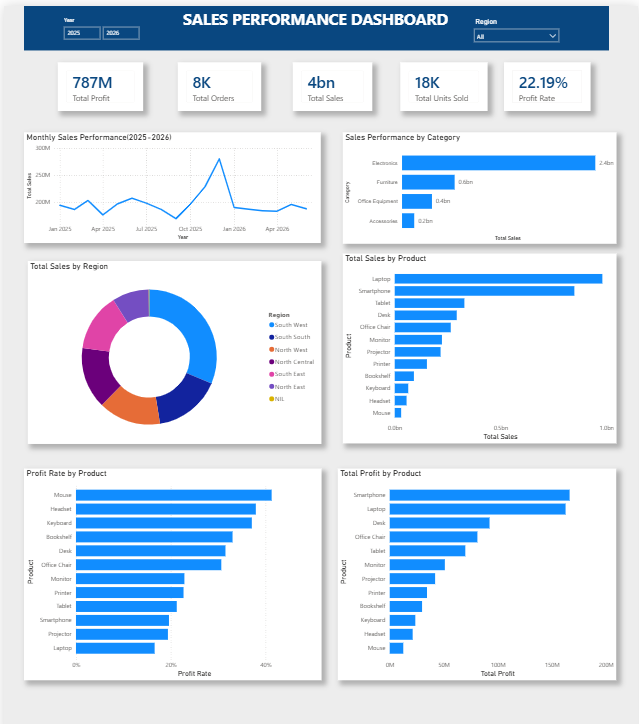

# Sales Performance Analysis

## Project Overview
This project analyses sales data to identify
business trends, evaluate performance, and
generate insights that support better
business decisions.

## Tools Used
- Microsoft Excel
- MySQL
- Power BI

## Project Objectives
- Analyse overall sales performance.
- Identify top-performing products.
- Compare sales across regions.
- Examine monthly sales trends.
- Evaluate profit rate.

## Project Process
1. Data cleaning using Excel.
2. Data storage and querying using MySQL.
3. Data visualisation using Power BI.
4. Interpretation of business insights.

## Key Deliverables
- Cleaned sales dataset.
- SQL queries.
- Interactive Power BI dashboard.
- Business insights and recommendations.

## Author
Oluwaseun Oni

## Dashboard Preview

