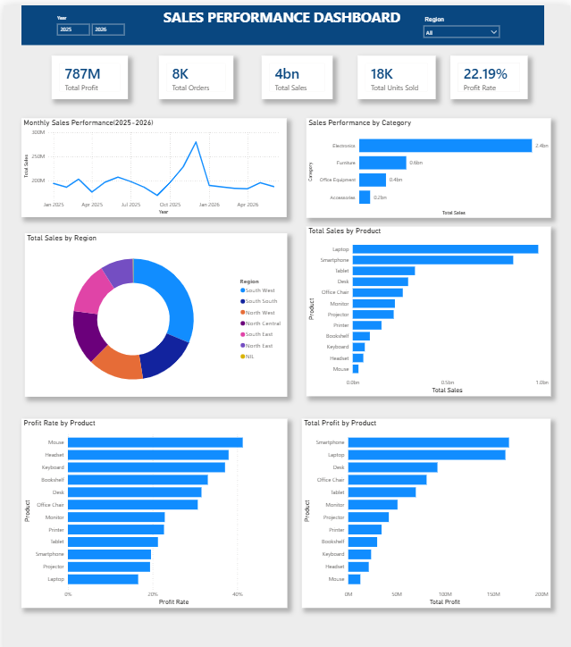

# Sales Performance Analysis

## Project Overview
This project analyses sales data to identify
business trends, evaluate performance, and
generate insights that support better
business decisions.

## Tools Used
- Microsoft Excel
- MySQL
- Power BI

## Project Objectives
- Analyse overall sales performance.
- Identify top-performing products.
- Compare sales across regions.
- Examine monthly sales trends.
- Evaluate profit rate.

## Project Process
1. Data cleaning using Excel.
2. Data storage and querying using MySQL.
3. Data visualisation using Power BI.
4. Interpretation of business insights.

## Key Deliverables
- Cleaned sales dataset.
- SQL queries.
- Interactive Power BI dashboard.
- Business insights and recommendations.

## Author
Oluwaseun Oni

## Dashboard Preview

## SQL Analysis

SQL was used to analyse sales performance, customer behaviour, product profitability, regional sales, and monthly trends.

### SQL Queries
- Overall Business KPIs
- Product Performance
- Category Performance
- Regional Performance
- Monthly Sales Trends
- Payment Method Analysis
- Top Customers
- Repeat Customers
- Product Profitability
- Data Quality Checks

[View SQL Queries](./SQL/sales_analysis.sql)

## Business Insights

### Key Performance Indicators
- Total Sales: Approximately 4 billion
- Total Profit: Approximately 787 million
- Total Orders: Approximately 8,000
- Total Units Sold: Approximately 18,000
- Overall Profit Rate: 22.19%

### Sales Performance
- Sales performance varied across the months, with a noticeable peak around December 2025.
- Sales declined after the peak and remained relatively lower during subsequent months.

### Product Performance
- Sales revenue was concentrated among a few leading products.
- Products differed in both sales contribution and profitability.
- The highest-revenue products were not necessarily the products with the highest profit rate.

### Regional Performance
- Sales were distributed across multiple regions.
- Some regions contributed a larger share of total revenue than others.

### Category Performance
- Categories contributed differently to overall sales.
- The leading category accounted for the largest portion of revenue.

## Business Recommendations

1. Prioritize inventory planning for high-performing products.
2. Investigate the reasons for the seasonal sales peak to improve future sales campaigns.
3. Review lower-performing products to determine whether pricing, marketing, or inventory adjustments are needed.
4. Focus marketing efforts on regions with growth potential.
5. Monitor product profit rates to ensure revenue growth translates into profitability.
